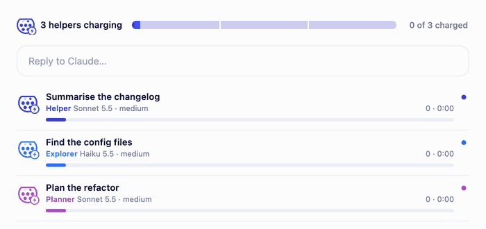

# ev-charging

A Claude Code mod that turns helper agents into an EV charging session.



When Claude splits a job across helper agents (subagents), a charging bar appears above the prompt:

- **One segment per helper.** Current flows along the charged part while they work, and the bar turns green, *Fully charged*, when the last one finishes.
- **A Type 2 plug** on the left: its pins light up one after another while charging, with a pulsing ⚡.
- It **hides itself** on your next message, or with ✕. In a normal conversation you never see it.

`/agents-info` (or the ×N button on the bar) opens the session panel: total session time and energy (tokens), then every helper as a plug, deep blue for general helpers, light blue for explorers, purple for planners, with its model, tokens and time. Pins glow green when a helper is done and go grey if it stopped.

It reads only what Claude Code reports about its own subagents. No network, no files, no other programs, and it adds nothing to Claude's prompt.

## Install

In Claude Code:

```
/plugin install ev-charging --marketplace juro-mont/claude-ev-charging
```

Then restart Claude Code. Mods need a recent Claude Code build.

## Credits

Adapted from [savvy-progress](https://github.com/johnnyvizz/claude-kit/tree/main/plugins/savvy-progress) by johnnyvizz (MIT): the walking crabs became plugs, and the bar follows any subagents instead of a savvy-flow plan.

## License

MIT, see [LICENSE](LICENSE).
